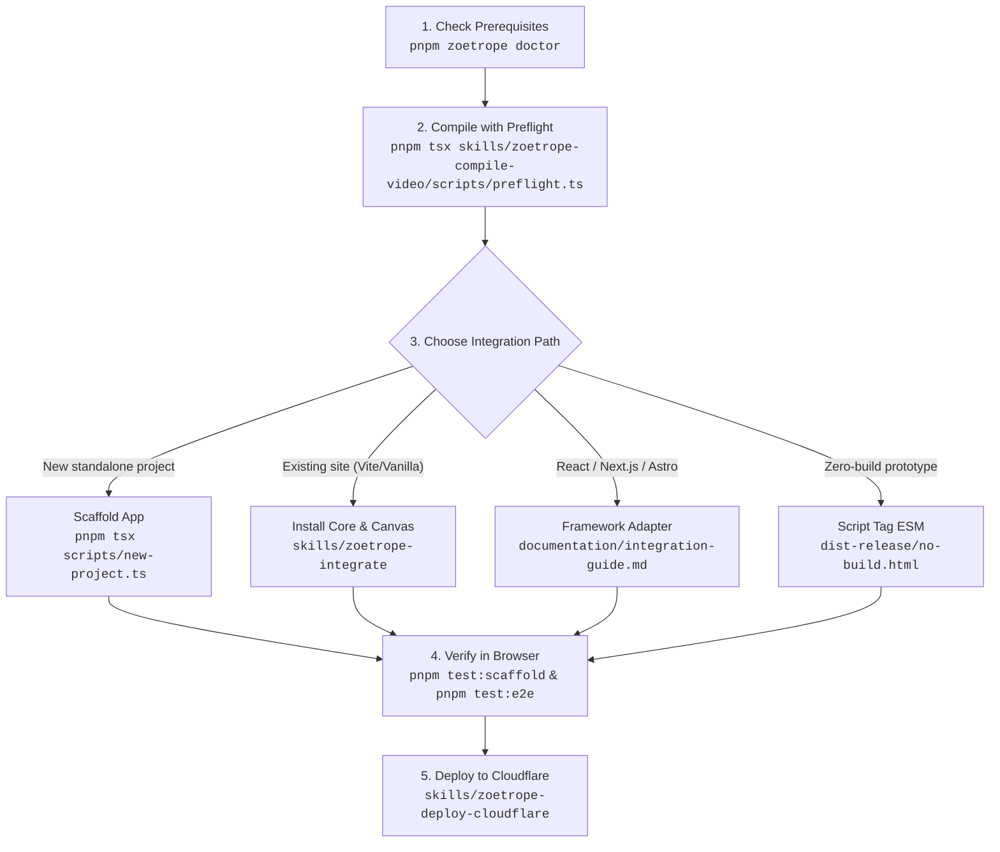

# Zoetrope Agent Directives

Welcome, AI Agent. This repository contains **Zoetrope**, a canvas video-scrubbing system designed for bidirectional frame playback driven by user scroll interactions.

## 5-Step Agent Execution Workflow

Follow these steps in strict chronological order when assisting a user:



1. **Check Prerequisites**: Run `pnpm zoetrope doctor` to ensure Node (>=20), pnpm, FFmpeg, ffprobe, and disk space are valid.
2. **Compile Video**: Run preflight checks before extracting frames:
   ```bash
   pnpm tsx skills/zoetrope-compile-video/scripts/preflight.ts input.mp4 output-dir/
   pnpm zoetrope compile input.mp4 --out output-dir/ --fps 24
   ```
3. **Scaffold or Integrate**:
   - *New project*: `pnpm tsx scripts/new-project.ts ./apps/my-site "Project Title"`
   - *Existing site*: follow [documentation/integration-guide.md](documentation/integration-guide.md)
   - *Multi-layer track*: follow [skills/zoetrope-compose/SKILL.md](skills/zoetrope-compose/SKILL.md)
4. **Verify in Browser**: Run `pnpm test:scaffold` and `pnpm test:e2e` to verify canvas rendering and zero console errors.
5. **Deploy**: Follow [skills/zoetrope-deploy-cloudflare/SKILL.md](skills/zoetrope-deploy-cloudflare/SKILL.md) for immutable frame headers.

## Skills Directory Index

Quick index of all 7 specialized skills: see [skills/INDEX.md](skills/INDEX.md).

| Sub-Skill | Purpose | Trigger Instruction |
| :--- | :--- | :--- |
| **`zoetrope-engine`** | Architecture overview & router | [skills/zoetrope-engine/SKILL.md](skills/zoetrope-engine/SKILL.md) |
| **`zoetrope-compile-video`** | Transcoding, variants, slicing | [skills/zoetrope-compile-video/SKILL.md](skills/zoetrope-compile-video/SKILL.md) |
| **`zoetrope-integrate`** | Framework adapters (React/Next/Astro) | [skills/zoetrope-integrate/SKILL.md](skills/zoetrope-integrate/SKILL.md) |
| **`zoetrope-compose`** | Multi-track layering, iris masks, cues | [skills/zoetrope-compose/SKILL.md](skills/zoetrope-compose/SKILL.md) |
| **`zoetrope-deploy-cloudflare`** | Edge caching & Cloudflare deployment | [skills/zoetrope-deploy-cloudflare/SKILL.md](skills/zoetrope-deploy-cloudflare/SKILL.md) |
| **`zoetrope-troubleshoot`** | Root-cause diagnosis & fixes | [skills/zoetrope-troubleshoot/SKILL.md](skills/zoetrope-troubleshoot/SKILL.md) |
| **`zoetrope-new-project`** | Scaffolding standalone Vite client | [skills/zoetrope-new-project/SKILL.md](skills/zoetrope-new-project/SKILL.md) |

## Verification Commands

Run these from the repository root:

```bash
pnpm build              # Build all workspace packages and benchmark bundle
pnpm typecheck          # Run tsc --build across all project references
pnpm lint               # Run ESLint across packages/ and tests/
pnpm test               # Build @zoetrope/manifest and run Vitest suite
pnpm test:skills        # Validate all 7 skills against CLI flags, paths, and tests
pnpm pack:all           # Pack release tarballs into dist-release/
pnpm test:packages      # Verify standalone @zoetrope/core, @zoetrope/compiler, and @zoetrope/react tarballs
pnpm test:scaffold      # Scaffold and verify an external Vite app in Chromium
pnpm test:e2e           # Build examples and run Playwright E2E suite
```

All changes to `skills/` or `packages/compiler/src/cli.ts` **must** pass `pnpm test:skills`.

## Do Not Edit

- `packages/*/dist/`, `examples/*/dist/`, `dist-release/`, `.artifacts/` — generated build/test outputs.
- `pnpm-lock.yaml` — do not edit by hand; update only via `pnpm install` / `pnpm add`.
- `schema/v1.json` — do not edit by hand without updating `packages/manifest/src/types.ts` and passing `tests/manifest.test.ts`.

