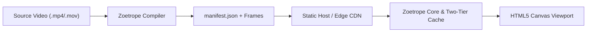

# Zoetrope

Zoetrope delivers bidirectional video playback driven entirely by user scroll interactions. By decoupling playback from native `<video>` decoders, it pre-decodes multi-resolution WebP frame sequences into a two-tier memory cache (decoded bitmaps + raw blobs) rendered directly to HTML5 Canvas. It is engineered specifically for interactive landing pages, product reveals, and scrollytelling narratives.

**10-Second Demo**: Compile any video and preview it live on a sticky viewport by running `pnpm demo:video <video.mp4>`.

## What's in the Box

| Component | Monorepo Package | Purpose |
| :--- | :--- | :--- |
| **Asset Compiler** | `@zoetropejs/compiler` | Multi-resolution responsive frame extractor with color fidelity (BT.709/601) and disk guard. |
| **Playback Engine**| `@zoetropejs/core` | Request horizon prefetcher, two-tier LRU cache, and RAF-driven canvas renderer. |
| **Composition** | `@zoetropejs/core` | Multi-track timeline sequencing, dynamic iris circle masks, and scroll-synced DOM cues. |
| **Adapters** | `@zoetropejs/react` | Ready-to-use wrappers for React and Next.js (`NextZoetropePlayer`, SSR-safe dynamic import). Astro is provided as an example in `examples/astro`. |
| **Agent Skills** | `skills/` | 7 modular agent skills for autonomous compilation, integration, debugging, and deployment. |

## Quick Start (Verified Standalone Sequence)

The exact sequence tested outside this monorepo by `pnpm test:scaffold`:

```bash
# 1. Check prerequisites (Node >= 20, pnpm, FFmpeg >= 6.0, ffprobe, disk space)
pnpm zoetrope doctor

# 2. Scaffold a clean standalone project outside this repository
pnpm tsx scripts/new-project.ts ../my-app "Hero Reveal"

# 3. Extract and compile video footage into the app's public assets
# Payload controls: --quality 80 (default), --desktop-width 1920 (default), --mobile-width 640 (default). Lower quality, fps or width reduces file size; effect on visual quality is (unverified) until checked.
pnpm zoetrope compile input.mp4 --out ../my-app/public/assets/hero --fps 24

# 4. Install dependencies using isolated lockfile
cd ../my-app && pnpm install --allow-build=esbuild

# 5. Build for production (verifies bundling and types)
pnpm build

# 6. Deploy build output (unverified, not tested)
pnpm dlx wrangler pages deploy dist/ --project-name hero-reveal
```

## Architecture



## Three Integration Paths

### Path A: No-Build Script Tag (Single ESM Bundle)

> Note: `dist-release/` is generated by `pnpm release:build`. This file must be served over HTTP (e.g. `pnpm dlx serve dist-release`), not opened directly as `file://`. Frame assets do not ship inside `dist-release/`; pass your manifest URL via `?manifest=<url>`.

```html
<div style="height: 300vh; position: relative;">
  <canvas id="viewport" style="position: sticky; top: 0; width: 100vw; height: 100vh;"></canvas>
</div>
<script type="module">
  import { Zoetrope } from './dist-release/zoetrope.min.js';
  const engine = new Zoetrope({
    manifest: '/assets/hero/manifest.json',
    canvas: document.getElementById('viewport'),
    renderer: { fit: 'cover' }
  });
  await engine.init();
  window.addEventListener('beforeunload', () => engine.destroy());
</script>
```

### Path B: Vite / Vanilla TypeScript

```typescript
import { Zoetrope } from '@zoetropejs/core';

const canvas = document.querySelector<HTMLCanvasElement>('#viewport')!;
const engine = new Zoetrope({
  manifest: '/assets/hero/manifest.json',
  canvas,
  renderer: { fit: 'cover' }
});
await engine.init();
window.addEventListener('beforeunload', () => engine.destroy());
```

### Path C: React / Next.js (`@zoetropejs/react`)

```tsx
import dynamic from 'next/dynamic';

// Next.js SSR-safe dynamic wrapper
const NextZoetropePlayer = dynamic(
  () => import('@zoetropejs/react').then((m) => m.NextZoetropePlayer),
  { ssr: false }
);

export function Hero() {
  return (
    <NextZoetropePlayer
      options={{
        manifest: '/assets/hero/manifest.json',
        renderer: { fit: 'cover' }
      }}
    />
  );
}
```

## For AI Agents

Export skills to your agent harness via `pnpm skills:install <dir>` or download `dist-release/skills.zip`. The root directives are indexed in [AGENTS.md](AGENTS.md) and [skills/INDEX.md](skills/INDEX.md):
- `zoetrope-engine`: Monorepo architectural overview and skill routing.
- `zoetrope-compile-video`: CLI flags, multi-variant extraction, disk guard, and preflight checks.
- `zoetrope-integrate`: Component integration patterns for Vanilla JS, React, Next.js, and Astro (`examples/astro`).
- `zoetrope-compose`: Multi-layer tracks, z-ordering, iris circular masks, and DOM cues.
- `zoetrope-deploy-cloudflare`: Cloudflare Pages hosting, immutable caching, and version hashes.
- `zoetrope-troubleshoot`: Root-cause diagnostic matrix for stalls, color shifts, and request storms.
- `zoetrope-new-project`: Automated Vite client scaffolding with demo layouts.

## Feature Status

| Feature | Status | Notes |
| :--- | :--- | :--- |
| **Canvas Renderer & Cover/Contain** | Stable | Chromium with emulated viewports; no real devices (unverified). |
| **Two-Tier Cache (Decoded + Blob)** | Stable | 0 repeated requests at idle, 0 re-fetches on reverse sweep (tests/e2e/examples-and-lifecycle.spec.ts). |
| **Color Fidelity (BT.709 & BT.601)**| Stable | Tested against FFmpeg ground truth (tests/compiler-color.test.ts). |
| **Multi-Layer Composition & Cues** | Stable | Tested: z-index, iris mask scaling, and DOM enter/leave cues (tests/composition.test.ts). |
| **Individual WebP Frames** | Stable | Default and recommended deployment format. |
| **Scaffolded App in Browser** | Stable | Verified in Chromium by test:scaffold with compiled clip and canvas pixels; physical phone is (unverified). |
| **AVIF Frame Sequences** | Experimental | Opt-in format (`--formats avif,webp`). |
| **CEPK Binary Pack Chunks** | Experimental | Opt-in chunked packing (`--packing chunked`). |
| **Mobile High-Velocity Scrub** | Unverified | Fling recovery marked (unverified-on-mobile) on physical low-end devices. |

## Known Limits & Unverified Items (unverified, not tested)

- **Physical Mobile Devices**: High-velocity touch scrubbing on physical low-end mobile devices is (unverified). Emulated viewports pass in Chromium.
- **Cloudflare Edge Deployment**: Live Cloudflare Pages and Workers deployment is (unverified, not tested).
- **Third-Party Content**: No videos, commercial footage, or image sequences are shipped in this repository. All test suites generate synthetic test clips on demand via FFmpeg (`testsrc`).
- See full guides: [Integration Guide](documentation/integration-guide.md), [Deployment Guide](documentation/deployment.md), and [Troubleshooting Catalog](skills/zoetrope-troubleshoot/references/bug-catalog.md).

## Contributing & License

Contributions are welcome. Run `pnpm typecheck`, `pnpm test`, and `pnpm test:scaffold` prior to opening pull requests. Distributed under the [MIT License](LICENSE).
