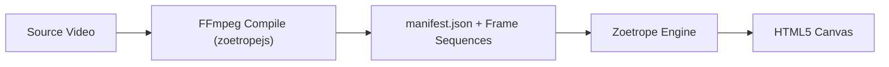

# ZoetropeJS

Scroll-scrubbed video that doesn't stutter.

Not yet benchmarked or tested on real mobile devices; see Known Gaps.

ZoetropeJS compiles a source video into responsive image frame sequences and renders them onto an HTML5 `<canvas>` driven by scroll progress. It does not decode video streams in the browser at runtime, has no audio playback, and renders frame 0 as a static poster when `prefers-reduced-motion: reduce` is active.

<!-- TODO: Add demo clip (GIF/WebM) -->
<!-- TODO: Add live demo link -->



## Install

The `@zoetropejs/core`, `@zoetropejs/compiler`, and `@zoetropejs/react` packages are **not yet published to npm**. Build the release tarballs inside a clone of this repository, then install them into your project by absolute path:

```bash
# 1. Inside a clone of the ZoetropeJS repository:
REPO=/path/to/Zoetrope
cd "$REPO" && pnpm install && pnpm build && pnpm pack:all

# 2. Inside your own project:
pnpm add "$REPO/dist-release/zoetropejs-core-0.1.0-rc.1.tgz"
pnpm add -D "$REPO/dist-release/zoetropejs-compiler-0.1.0-rc.1.tgz"
# Optional React / Next.js adapter (requires @zoetropejs/core and react >=18.0.0)
pnpm add "$REPO/dist-release/zoetropejs-react-0.1.0-rc.1.tgz"
```

## Quickstart

`npx zoetropejs` works after the `@zoetropejs/compiler` tarball is installed in your project. Compile a video into `manifest.json` and frame sequences:

```bash
npx zoetropejs compile input.mp4 --out ./public/assets/clip --fps 24
```

Then drive a `<canvas>` in vanilla TypeScript/JavaScript with `Zoetrope`:

```ts
import { Zoetrope, type AnimationManifest } from '@zoetropejs/core';
import rawManifest from './public/assets/clip/manifest.json';

const manifest = rawManifest as AnimationManifest;
const canvas = document.querySelector('canvas')!;
const player = new Zoetrope({ canvas, manifest });

// Clean up listeners, caches, and RAF loop when unmounting:
// player.destroy();
```

## React & Next.js

`useZoetrope` manages the `Zoetrope` lifecycle and returns `canvasRef`. `ZoetropeCanvas` is a styled `<canvas>` wrapper that loads nothing on its own; use it together with `useZoetrope`:

```tsx
import { type AnimationManifest } from '@zoetropejs/core';
import { useZoetrope, ZoetropeCanvas } from '@zoetropejs/react';

export function HeroPlayer({ manifest }: { manifest: AnimationManifest }) {
  const { canvasRef, isReady } = useZoetrope({ manifest });
  return (
    <div>
      <ZoetropeCanvas canvasRef={canvasRef} />
      <span>{String(isReady)}</span>
    </div>
  );
}
```

For Next.js App Router, `NextZoetropePlayer` wraps `useZoetrope` in an SSR-safe client component:

```tsx
import { NextZoetropePlayer } from '@zoetropejs/react';
import type { AnimationManifest } from '@zoetropejs/core';

export function NextHero({ manifest }: { manifest: AnimationManifest }) {
  return <NextZoetropePlayer options={{ manifest }} />;
}
```

## CLI Reference

The `@zoetropejs/compiler` package provides the `zoetropejs` binary with three commands (`compile`, `validate`, `doctor`; there is no `init` command):

### `zoetropejs compile <input-video> --out <output-dir> [options]`

- `--out <dir>`: Output directory for manifest and frames (required)
- `--id <string>`: Unique animation sequence ID (default: input basename)
- `--variant <spec>`: Define variant as `"id:width:height:minWidth"` (default: `desktop:1920:1080:768` and `mobile:640:360:0`)
- `--format <fmt>`: `webp | avif | jpeg` (default: `webp`)
- `--formats <list>`: Comma-separated format list (e.g. `avif,webp`)
- `--quality <0-100>`: Compression quality (default: `80` for `webp`, CRF `32` for `avif`, `85` for `jpeg`; higher is better for `webp`/`jpeg`, lower is better for `avif` CRF)
- `--desktop-width <n>`: Desktop variant target width in pixels (default: `1920`)
- `--mobile-width <n>`: Mobile variant target width in pixels (default: `640`)
- `--fps <n>`: Target frame rate (default: video source fps)
- `--step <n>`: Frame sampling step (default: `1`)
- `--start <timestamp>`, `--end <timestamp>`: Clip start/end time (e.g. `"00:00:02"` or `"2.5"`)
- `--packing <mode>`: `individual | chunked | range` (default: `individual`)
- `--chunk-size <n>`: Frames per chunk when `packing=chunked` (default: `24`)
- `--fit <cover|contain>`: Aspect ratio fit mode (default: `cover`)
- `--checksum`: Compute and embed SHA-256 checksums
- `--anchors <step>`: Generate 1/4 resolution anchor frames every `N` frames
- `--motion-lut <mode>`: `"auto" | "linear" | <path-to-json>`
- `--force`: Ignore build cache and recompile all frames

### `zoetropejs validate <manifest-path> [--deep] [--json]`

- `--deep`: Parse image headers to verify dimensions and integrity
- `--json`: Output validation results as structured JSON

### `zoetropejs doctor`

Checks Node.js, pnpm, FFmpeg version and `bt601` scale filter, encoders (`libwebp`, `libaom-av1`, `mjpeg`), `ffprobe`, and free disk space.

## Requirements

- **Node.js**: `>= 20`
- **FFmpeg**: FFmpeg `7.0.2` (CI) and `9.0.1` (local) are the versions tested; the `>= 6.0` minimum is unverified.
  - Encoders per format: `libwebp` (WebP), `libaom-av1` (AVIF anchors), `mjpeg` (JPEG)
- **React**: `>= 18.0.0` (when using `@zoetropejs/react`)

## Feature Status

- **Verified**: covered by CI or Playwright e2e
- **Experimental**: works locally, limited testing
- **Unverified**: no testing on target platform

| Feature / Subsystem | Status | Notes |
| :--- | :--- | :--- |
| Deterministic frame lookup (`round(p * (N - 1))`) | **Verified** | Covered by `tests/e2e/browser-verification.spec.ts` |
| Two-tier cache (`BlobCache` + directional LRU) | **Verified** | Covered by `tests/cache.test.ts` and e2e |
| Variant selection (desktop vs mobile) | **Verified** | Covered by `tests/manifest.test.ts` and e2e |
| Low-res anchor fallback & 404/corrupt fault handling | **Verified** | Covered by `tests/e2e/browser-verification.spec.ts` |
| BT.709/BT.601 color pipeline | **Unit-tested** | Covered by `tests/compiler-color.test.ts` |
| Layered composition (`ZoetropeComposition`) | **Verified** | Covered by `tests/composition.test.ts` and e2e |
| React / Next.js (`@zoetropejs/react`) & Astro island | **Verified** | Verified on the bundled example apps (Chromium) |
| `prefers-reduced-motion`, resize debounce, BFCache, context loss | **Verified** | Covered by `tests/e2e/examples-and-lifecycle.spec.ts` |
| `WorkerPoolDecoder` & `WebCodecsImageDecoder` | **Experimental** | Opt-in flags; limited testing |
| CEPK / Range packing (`--packing chunked\|range`) | **Experimental** | Requires HTTP byte-range support |
| Adaptive DPR downgrade | **Experimental** | Limited testing |
| Real iOS Safari / physical mobile devices | **Unverified** | E2E uses Chromium desktop + Pixel 7 emulation |
| Firefox & legacy Safari (`< 16.4` AVIF) | **Unverified** | No automated e2e coverage |

## Known Gaps

- No testing on real iOS Safari or physical Android Chrome hardware; e2e runs on Chromium desktop and Pixel 7 emulation.
- No automated e2e coverage on Firefox or WebKit/Safari.
- No benchmark comparing ZoetropeJS against a plain image array or an all-keyframe `<video>`.
- No built-in poster fallback outside `prefers-reduced-motion` frame 0.
- Packages are not yet published to npm.
- The standalone `@zoetropejs/*` snippets above were typechecked (`tsc --noEmit`) against a compiled manifest, not executed in a browser.

## Examples

- [examples/basic-scroll](examples/basic-scroll) — Vanilla Vite (`^6.2.0`) scroll-scrubbing example
- [examples/layered-composition](examples/layered-composition) — Multi-track `ZoetropeComposition` with Vite (`^6.2.0`)
- [examples/nextjs](examples/nextjs) — Next.js (`15.2.4`) + React (`19.3.1`) App Router example
- [examples/astro](examples/astro) — Astro (`^7.4.5`) island hydration example
- [examples/no-build](examples/no-build) — Zero-build static HTML example

## Comparison with alternatives

ZoetropeJS is not benchmarked; the notes below compare approach and tradeoffs.

- **`scrolly-video`** ([github.com/dkaoster/scrolly-video](https://github.com/dkaoster/scrolly-video)):
  - JavaScript library and component suite for scroll-based video playback across vanilla JS, React, Vue, Svelte, and Astro using WebCodecs, `playbackRate`, and `currentTime`.
  - ZoetropeJS adds an FFmpeg frame compiler, a manifest, responsive variant selection, and a bounded cache.
- **GSAP ScrollTrigger (canvas image sequence)** ([gsap.com/docs/v3/Plugins/ScrollTrigger](https://gsap.com/docs/v3/Plugins/ScrollTrigger/)):
  - Scroll animation plugin often paired with a preloaded `Image[]` array drawn to `<canvas>` on update.
  - ZoetropeJS adds an FFmpeg frame compiler, a manifest, variant selection, and a bounded cache.
- **Plain image array swapped on scroll**:
  - Preloading an array of images and swapping `` `src` or drawing to `<canvas>` by scroll index.
  - ZoetropeJS adds an FFmpeg frame compiler, a manifest, variant selection, abort-on-reversal, and a bounded cache.
- **All-keyframe `<video>` (`ffmpeg -g 1`) scrubbed via `currentTime`**:
  - Re-encoding a video so every frame is an intra-frame and setting `video.currentTime` on scroll.
  - ZoetropeJS compiles to individual image frames and renders them to `<canvas>` with a manifest and bounded cache.
- **`@diracleo/vue-scrubbable-video`** ([npmjs.com/package/@diracleo/vue-scrubbable-video](https://www.npmjs.com/package/@diracleo/vue-scrubbable-video)):
  - Vue package (`0.0.8`) for scrubbable video playback.
  - ZoetropeJS is framework-agnostic at its core and compiles to image frame sequences.
- **`reel-it`**:
  - Not verified.
- **Existing AI agent skills for scroll video** (e.g., [github.com/oso95/scroll-world](https://github.com/oso95/scroll-world)):
  - `SKILL.md` agent workflow that builds scroll-scrubbed landing pages using a continuous pre-rendered video chain and a vanilla JS scrub engine.
  - ZoetropeJS pairs its `skills/` directory with its own `@zoetropejs/compiler` and `@zoetropejs/core` runtime.

### When another tool may fit

- **Byte-size priority**: a single video file is typically much smaller than an extracted frame sequence; this has not been measured against ZoetropeJS output.
- **Zero build step**: a plain `<video>` scrubbed via `currentTime` needs no frame-extraction step or manifest.
- **Existing GSAP setup**: if you already use GSAP `ScrollTrigger` for page choreography and have a short, pre-exported image sequence, a `ScrollTrigger` canvas loop uses that existing setup.

## Contributing

```bash
pnpm install
pnpm build
pnpm typecheck
pnpm lint
pnpm test
pnpm test:packages
pnpm test:scaffold
pnpm test:e2e
```

## License

MIT — see [LICENSE](LICENSE) and [https://github.com/FairyTail-100/Zoetrope](https://github.com/FairyTail-100/Zoetrope).
